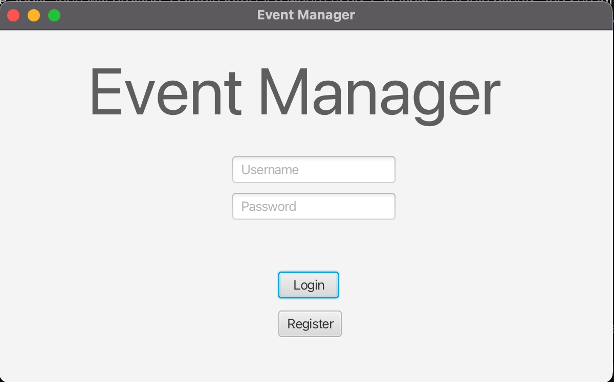
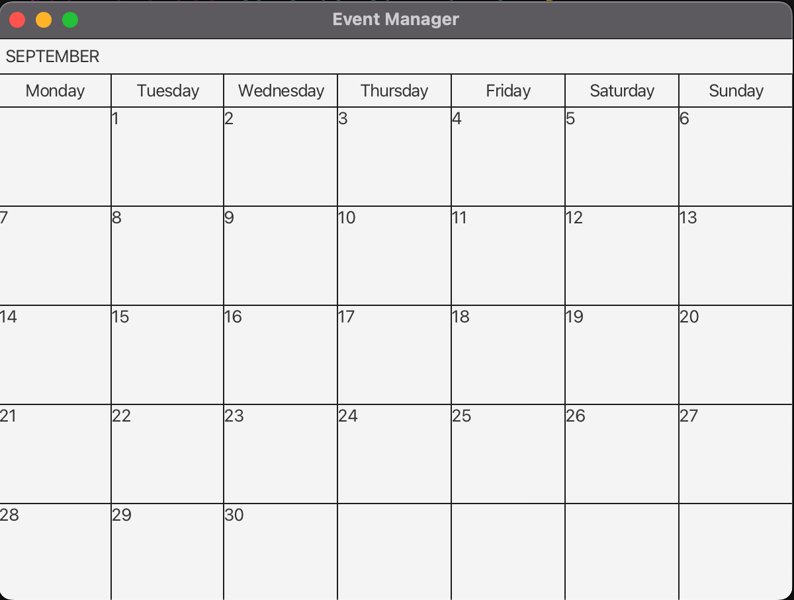

# Event Manager

Event Manager is an application for creating, viewing, and managing events. The application is intended to make it easy for users to find relevant events and for event organizers to create and manage events.

The application will provide a simple interface where users can view available events and see information such as the event name, date, and description. Users will be able to view, sign up to and remove themselves from events. Event organizers will be able to create new events that are then available to users.

## Screenshot

*Example screenshot of the Event Manager application.*

## Initial User Stories

### View events

> As a user, I want to see a list of available events so that I can find events I am interested in attending.
[Issue #11](https://git.ntnu.no/IT1901-2026-groups/gr2607/issues/11)

The user should be able to view available events and see (for example) its name, date, and description.

### Register for events

> As a user, I want to register for events so that event organizers know that I am attending.
[Issue #11](https://git.ntnu.no/IT1901-2026-groups/gr2607/issues/11)

The user should be able to register for available events, and this should be persistent.

### Access the application with an account

> As a user, I want to be able to access the application through registering an account, or logging into an account I have already created.
[Issue #21](https://git.ntnu.no/IT1901-2026-groups/gr2607/issues/21)

The user should be able to create an account or log into one they have already created.

## Dependancies

Requires Java 17 or newer
Requires Maven
