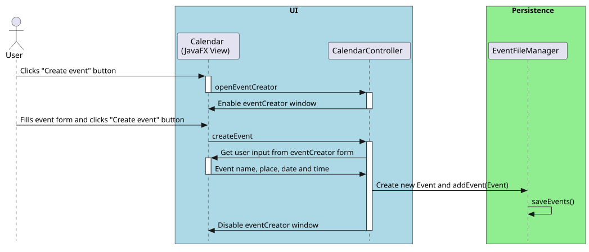
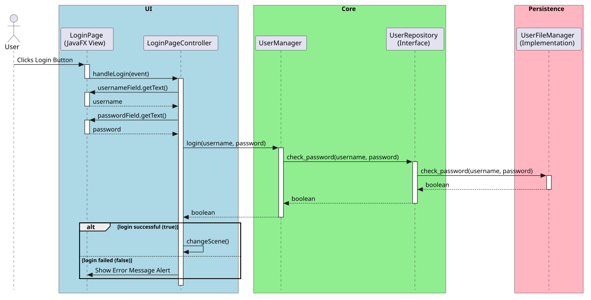
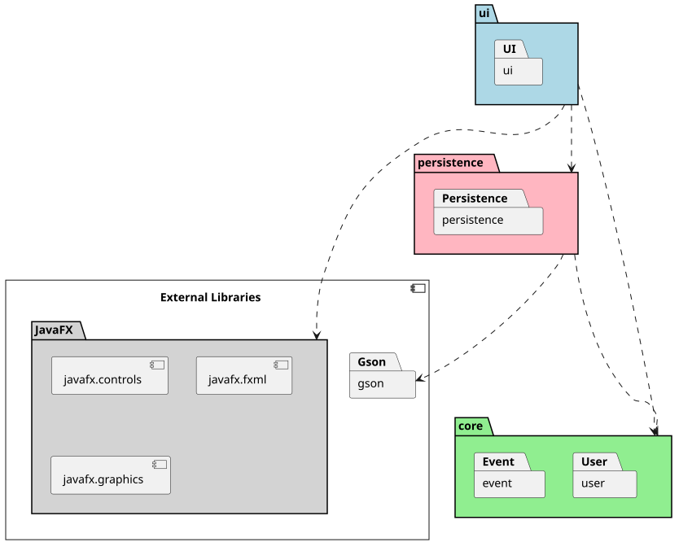

# Project architecture

The project is split into three modules, `core`, `persistence` and UI, where the different modules have different responsibilities.  
Under are diagrams used to illustrate different methods and aspects of the project.

## Sequence diagram for createEvent() method

## Sequence diagram for login

## Module dependency diagram

