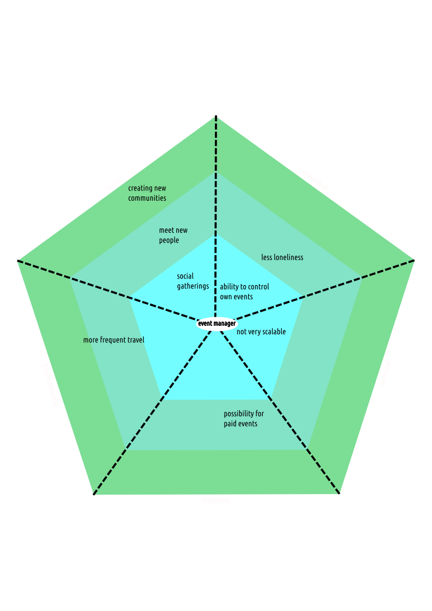

# Sustainability practices

We have valued our products sustainability based on the Sustainability Awareness Framework (SusAF)

Through that framework we value the sustainability based on 5 factors:
- Individual sustainability
- Social sustainability
- Technical sustainability
- Economical sustainability
- Environmental sustainability

We visualised the effects of our event manager app in a Sustainability Awareness Diagram (SusAD), sorted into immediate, enabling and structural effects.

## Individual sustainability
The immediate effect is that users have the ability to control their own events, and which events they want to join. 
However, since all event are open to all users, it is not possible to have closed or exclusive events.

An enabling effect is less loneliness, since it becomes easier to find something to attend. 

## Social sustainability
This is where the app has its strongest effect. 
Immediately, it supports social gatherings. 
This enables users to meet new people, and in the long term it can lead to the creation of new communities. 

The risks are fake events, harassment and people being excluded. 

## Technical sustainability
The app is currently not very scalable, since all users are able to see and attend all events, the calendar may become too cluttered with many users.
If the app grows, it might be a viable option to split the calendar to multiple calendars, for each community.

## Economical sustainability
While the app doesn't have the ability to create paid events, it is probable that events that require some form of payment will be made, such as going to the cinema together or other entrance fees, which gives organisers a way to earn money and cover costs. 
The app itself also needs a way to cover its hosting and development costs.

## Environmental sustainability
The app's most noticeable environmental effect is more frequent travel, since more events means more people travelling to them. 
It might however also have the opposite effect, that users attend more events in their local community.
Server and device energy use is a smaller effect, but still worth keeping in mind.

## Summary
The app has clear social and individual benefits, but its weaknesses are scalability and the added travel it can cause. 

